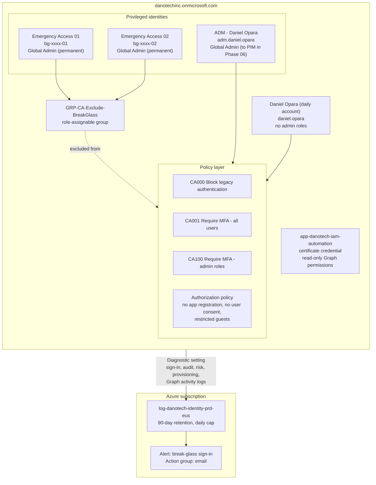
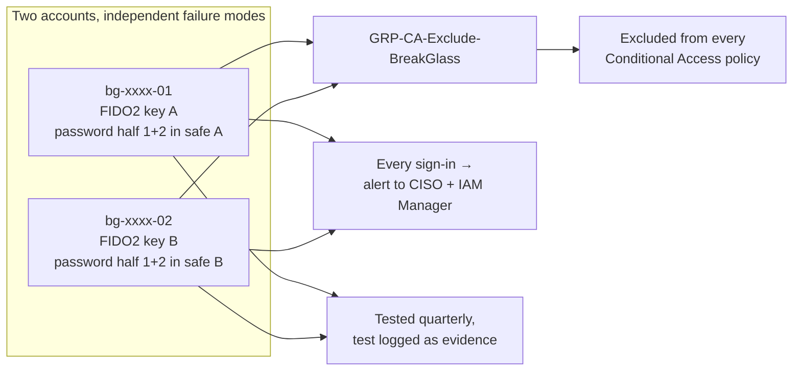
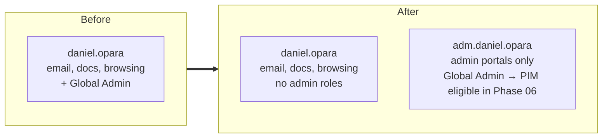

# Phase 01: Tenant Foundation and Hardening

## Scenario

It's Monday morning at DanotechInc's Atlanta HQ. The Entra tenant `danotechinc.onmicrosoft.com` has exactly one administrator: the CEO, Daniel Opara, who signs in with that same account to read email, approve invoices and review sales decks.

Oliver Hughes, the CISO, puts the risk plainly in the program kick-off: *"One phishing email to Daniel and someone else owns every identity in this company. And if Daniel loses his phone on a trip to Lagos, nobody can get back in."*

Before the IAM team brings 200 people into the tenant (Phase 04), Adaeze Nwosu's team has to make the tenant safe to build on. This phase does that.

## What DanotechInc wants

1. **Guaranteed recovery.** Two emergency access ("break-glass") accounts that work even if Conditional Access, MFA or federation breaks, and that set off an alarm whenever they're used.
2. **No privileged daily driver.** Daniel keeps his normal account for daily work, with no admin rights. Admin work moves to a separate, dedicated admin account.
3. **Safe defaults.** Ordinary users can't register apps, consent to apps on the company's behalf, create tenants or invite guests freely.
4. **Baseline Conditional Access** that is at least as strong as security defaults, so the tenant is ready for the full Zero Trust design in Phase 07.
5. **Automation identity.** A certificate-authenticated app registration for unattended scripts, starting with read-only permissions.
6. **Logs from day one.** Every sign-in, audit, risk and provisioning event exported to Log Analytics with 90-day retention, so Phases 14–16 have history to analyse.

## Target architecture

## Design decisions

### Break-glass accounts

| Decision | Reason |
|---|---|
| **Two** accounts, not one | One account is a single point of failure: a lost key or a locked account would mean no recovery. Two accounts with separately stored credentials give redundancy. |
| Cloud-only, `onmicrosoft.com` UPN | They must work when anything else (federation, a custom domain, an external IdP) is broken. |
| Not tied to a person, random UPN token | Nobody leaves the company with them. A random token means an attacker can't guess the name from a staff list. |
| **Permanent** Global Admin, never in PIM | PIM activation depends on MFA and on PIM working. Break-glass is the account you use when those are broken. |
| Phishing-resistant MFA (FIDO2/passkey) | Microsoft enforces mandatory MFA for Azure and admin portal sign-ins, so break-glass accounts still need MFA. A FIDO2 key is the strongest option and has no dependency on a phone. |
| Excluded from all CA policies via one **role-assignable** group | One group to exclude means one place to verify. Role-assignable groups can only be modified by Privileged Role Administrators or Global Admins, so a lower-tier admin can't quietly add themselves to the exclusion. |
| Sign-ins alert immediately | A break-glass account should never sign in without a reason. Any use is either an emergency or an incident. |

### Separate admin account for the CEO

The daily account is the one exposed to phishing links, malicious attachments and risky websites. Separating admin rights means a compromise of the daily account doesn't hand an attacker the tenant. Phase 06 extends this pattern to the IAM team and converts standing admin rights to just-in-time (PIM) eligibility.

### Why replace security defaults now

Security defaults give basic MFA and block legacy authentication, but they can't have exclusions (so break-glass accounts can't be excluded) and can't be tuned. Conditional Access and security defaults can't be enabled together. This phase replaces security defaults **like for like** with three Conditional Access policies, so protection never drops. Phase 07 then builds the full Zero Trust policy set on top.

### Baseline Conditional Access

| Policy | Users | Apps | Control | Why now |
|---|---|---|---|---|
| `CA000-AllUsers-AllApps-BlockLegacyAuth` | All users, excluding break-glass | All | Block legacy protocols (EAS, IMAP/POP/SMTP auth) | Legacy protocols can't do MFA and are the main target of password-spray attacks. |
| `CA001-AllUsers-AllApps-RequireMFA` | All users, excluding break-glass | All | Require MFA | Replaces the security defaults MFA requirement. |
| `CA100-Admins-AllApps-RequireMFA` | 14 privileged directory roles, excluding break-glass | All | Require MFA | Duplicates CA001 today on purpose: it's the policy Phase 07 upgrades to phishing-resistant MFA for admins, without touching the workforce policy. |

### Tenant hardening settings

| Setting | Value | Reason |
|---|---|---|
| Users can register applications | No | App registrations become identities with credentials. They should be created deliberately, through the IAM team. |
| User consent to applications | Disabled, admin consent workflow on | Illicit consent grants are a common way to steal data without stealing a password. Users can still request an app; an admin reviews it. |
| Users can create security groups | No | Groups grant access. Ad-hoc groups become ungoverned access. |
| Users can create tenants | No | Prevents shadow tenants outside DanotechInc's controls. |
| Guest invitations | Admins and Guest Inviter role only | Guests are governed through entitlement management (Phase 12). |
| Guest user permissions | Most restrictive | Guests can see only their own profile, not browse the directory. |
| Email-verified self-service sign-up | Disabled | Stops people creating unmanaged ("viral") accounts in the tenant. |
| Passkey (FIDO2) method | Enabled | Required for break-glass and admins now; extended to everyone in Phase 07. |

### Logging pipeline

Entra ID keeps sign-in and audit logs for 30 days at P1/P2. That's too short for incident investigation and audit sampling. A diagnostic setting streams logs to Log Analytics with 90-day retention and a daily ingestion cap to control cost. Microsoft Sentinel is **not** enabled yet. Its free trial is time-limited, so it's switched on in Phase 14, when it will actually be used.

## Scripts

| Script | What it does |
|---|---|
| [`00-Install-Tooling.ps1`](scripts/powershell/00-Install-Tooling.ps1) | Installs Graph and Az PowerShell modules |
| [`01-Get-TenantBaseline.ps1`](scripts/powershell/01-Get-TenantBaseline.ps1) | Exports current tenant state (licences, roles, policies) as evidence |
| [`02-New-BreakGlassAccounts.ps1`](scripts/powershell/02-New-BreakGlassAccounts.ps1) | Creates break-glass accounts, exclusion group, GA assignments; enables passkeys |
| [`03-New-AdminAccount.ps1`](scripts/powershell/03-New-AdminAccount.ps1) | Creates `adm.daniel.opara` |
| [`04-Set-TenantHardening.ps1`](scripts/powershell/04-Set-TenantHardening.ps1) | Applies authorization and consent settings |
| [`05-Deploy-BaselineConditionalAccess.ps1`](scripts/powershell/05-Deploy-BaselineConditionalAccess.ps1) | Disables security defaults and deploys CA000, CA001, CA100 |
| [`06-Remove-StandingAdminFromDailyAccount.ps1`](scripts/powershell/06-Remove-StandingAdminFromDailyAccount.ps1) | Removes Global Admin from Daniel's daily account, with lockout guard |
| [`07-New-AutomationApp.ps1`](scripts/powershell/07-New-AutomationApp.ps1) | Creates the certificate-based automation app |
| [`08-Set-EntraDiagnosticSettings.ps1`](scripts/powershell/08-Set-EntraDiagnosticSettings.ps1) | Creates Log Analytics workspace and Entra diagnostic setting |
| [`tenant_baseline_report.py`](scripts/python/tenant_baseline_report.py) | App-only Python report proving the automation identity works |

## Controls delivered

| Control | Evidence |
|---|---|
| Emergency access exists and is tested | `evidence/YYYYMMDD-breakglass-test.png`, sign-in log entry |
| No standing admin on daily accounts | `evidence/YYYYMMDD-role-assignments.json` |
| MFA enforced for all users and admins | `evidence/YYYYMMDD-ca-policies.json` |
| Legacy authentication blocked | Same |
| User consent disabled | `evidence/YYYYMMDD-authorization-policy.json` |
| Logs retained 90 days | Screenshot of workspace retention and diagnostic setting |
| Break-glass use is alerted | Alert rule screenshot, test alert email |

**Walkthrough:** [WALKTHROUGH.md](WALKTHROUGH.md)
**Previous:** [Phase 00](../phase-00-program-charter/) · **Next:** [Phase 02: Identity data model](../phase-02-identity-data-model/)
