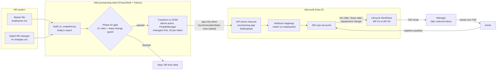
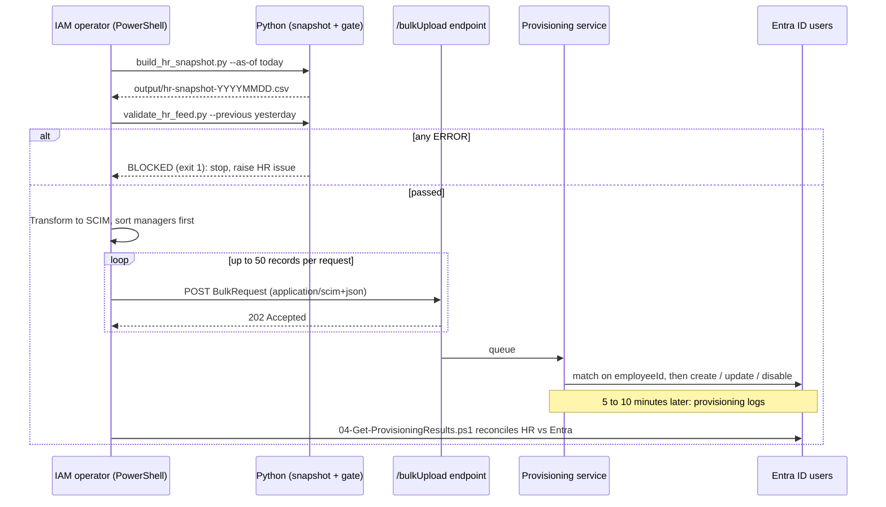
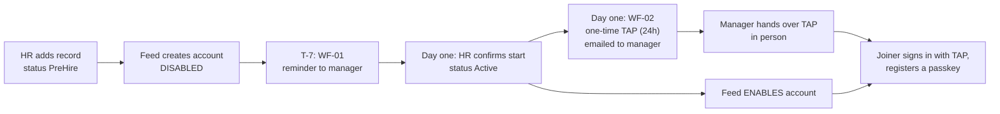
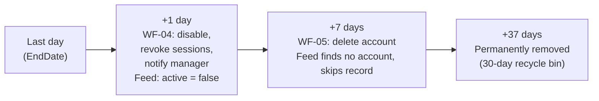

# Phase 04: JML Lifecycle Automation

## Scenario

The readiness assessment found seven former employees still holding Salesforce or GitHub access, up to 11 months after leaving (finding F-02). New hires waited days for accounts, and their first password usually arrived in a chat message.

Over the next two weeks, HR has a busy calendar:

| Date (Nov 2026) | Event | Person |
|---|---|---|
| 6 | Last day | Sofía Reyes, Sales Development Representative |
| 9 | First day | Niamh Jones, Account Executive (Atlanta) |
| 9 | HR confirms a start that was never recorded | Nicole Reed, Account Executive (started 2 Nov) |
| 10 | Transfer from Sales Operations to Finance | Miguel Hernández |
| 13 | Last day | Ebere Bello, Content Strategist |
| 16 | First day | Valeria Morales, Senior Software Engineer |
| 17 | Internship ends early, by agreement | Danielle Brown, Software Engineer Intern |
| 20 | Last day | María Castillo, Software Engineer |

Tunde Afolabi (HR Operations) wants each event handled **from the HR record alone**: no tickets, no Slack messages, no one remembering to do something. Oliver Hughes (CISO) adds two conditions: *no new hire ever receives a password*, and *nobody keeps access after their last day*.

## What DanotechInc wants

1. **Accounts created, updated and disabled from HR data only**, through the quality gate built in Phase 02.
2. **Joiners** get a disabled account before day one, and on day one a one-time Temporary Access Pass (TAP), delivered through their manager, to register a passkey. No passwords.
3. **Movers'** access follows their new job automatically, and their manager is told.
4. **Leavers** keep access through their last day, lose it immediately after, and their account is deleted 7 days later.
5. **Evidence** of every create, change, disable and delete, per person.
6. **Safety nets** so a broken HR export can't disable the company.

## Target architecture



Two Microsoft components divide the work:

| Component | Job | Decides |
|---|---|---|
| **API-driven inbound provisioning** | Keeps each Entra ID account in step with its HR record: create, update attributes, enable, disable | *What the account looks like* |
| **Lifecycle Workflows** | Runs tasks at lifecycle moments: before day one, on day one, on a job change, after the last day | *What happens around the account* |

## The daily feed cycle



## Joiner, mover and leaver design

### Joiners: no password, ever



- **HR, not the calendar, enables the account.** If the hire date arrives but HR hasn't confirmed the start, the account stays disabled. That's what happened with Nicole Reed: she started on 2 November, HR never updated her status, and the Phase 02 gate flagged it. HR confirms on 9 November (change CHG-003).
- **The TAP goes to the manager, not the joiner.** The joiner has no mailbox yet, and a manager handing it over in person also confirms the right person received it.
- **One-time and short-lived.** The TAP works once, for 24 hours from the hire date. Its only use is registering a passkey, which Phase 07 makes the standard sign-in method.

### Movers: access follows the job

When Miguel Hernández moves from Sales Operations to Finance FP&A on 10 November, HR changes nine fields in one change (CHG-004). The feed updates his account, and from Phase 05 onwards his dynamic group memberships change with it: he leaves `JR-SAL-LEADER` and joins `JR-FIN-FPA`, losing Salesforce manager rights and gaining expense auditor access, exactly as the Phase 03 model predicts. **WF-03** emails his new manager, Kwame Asante, so a human is aware of the change.

This is the direct fix for "copy Ama": a mover loses the old role instead of accumulating both.

### Leavers: access through the last day, then gone



- **Disabled twice, independently.** WF-04 disables the account at the first run after the last day, and the HR feed sets `active = false` on its next run. If either system is late, the other still acts.
- **Sessions revoked.** Disabling stops new sign-ins; revoking refresh tokens also ends sessions already open in apps.
- **Deletion after 7 days** (a lab choice; production typically uses 30 or more). Deleted users sit in the recycle bin for 30 days, so mistakes are recoverable.
- **No resurrection.** The feed sends a *Terminated* record only if that person still has an account (to disable it). Once WF-05 has deleted the account, there's nothing to disable, so the record is skipped. Otherwise the next upload would recreate the account WF-05 just deleted. The same rule stops the first load from creating an account for Sofía Reyes, who left the day before.

## Lifecycle Workflows

Defined as code in [`config/workflows/`](config/workflows/). WF-02 is built by hand in the portal, then `02-Deploy-LifecycleWorkflows.ps1` creates the other four and checks WF-02 against its definition.

| Workflow | Category | Trigger | Tasks |
|---|---|---|---|
| WF-01 Pre-hire reminder | Joiner | Hire date − 7 days | Send onboarding reminder email to manager |
| WF-02 Day-one TAP | Joiner | Hire date | Generate TAP (one-time, 24h) and email it to the manager |
| WF-03 Mover notification | Mover | Department or job title changes | Notify manager of the move |
| WF-04 End of last day | Leaver | Leave date + 1 day | Disable account · revoke refresh tokens · email manager |
| WF-05 Delete | Leaver | Leave date + 7 days | Delete user |

All five are scoped to `companyName eq 'DanotechInc'`, so guests and admin accounts are never processed.

> **Timing rule:** a time-based workflow doesn't fire for users whose trigger date is earlier than the workflow's creation date. The workflows must exist before 9 November to catch Niamh Jones. Nicole Reed's hire date (2 Nov) predates them, so she gets her TAP from an **on-demand** run.

## Attribute mappings

The provisioning app maps the SCIM payload to Entra ID. Matching is on `externalId → employeeId`, so existing accounts are updated, never duplicated. That's how Daniel Opara's account (stamped `DT01001` in Phase 01) is adopted.

| SCIM attribute (source) | Entra ID attribute (target) | Applied |
|---|---|---|
| `externalId` | `employeeId` | Always. **Matching attribute, precedence 1** |
| `userName` | `userPrincipalName` | **On create only** (contract: UPN isn't regenerated) |
| `active` | `accountEnabled` | Always |
| `displayName`, `name.givenName`, `name.familyName` | `displayName`, `givenName`, `surname` | Always |
| `title` | `jobTitle` | Always |
| `addresses[type eq "work"].locality` / `.country` | `city` / `country` | Always |
| `enterprise:department` | `department` | Always |
| `enterprise:costCenter` / `enterprise:division` | `employeeOrgData` cost centre / division | Always |
| `enterprise:organization` | `companyName` | Always |
| `enterprise:manager.value` | `manager` | Always (resolved by the manager's employeeId) |
| `danotech:JobCode` / `JobLevel` / `JobFamily` / `PeopleManager` | `extensionAttribute1` / `2` / `3` / `4` | Always |
| `danotech:EmployeeType` | `employeeType` | Always |
| `danotech:HireDate` / `LeaveDate` | `employeeHireDate` / `employeeLeaveDateTime` | Always |
| `danotech:UsageLocation` | `usageLocation` | Always |
| `danotech:Office` | `officeLocation` | Always |
| `danotech:MailNickname` | `mailNickname` | On create only |

`danotech:` is the custom SCIM extension `urn:ietf:params:scim:schemas:extension:danotech:1.0:User`, added to the app's attribute list in the walkthrough. A single record looks like this:

```json
{
  "method": "POST", "bulkId": "…", "path": "/Users",
  "data": {
    "schemas": ["urn:ietf:params:scim:schemas:core:2.0:User",
                "urn:ietf:params:scim:schemas:extension:enterprise:2.0:User",
                "urn:ietf:params:scim:schemas:extension:danotech:1.0:User"],
    "externalId": "DT01102",
    "userName": "niamh.jones@danotechinc.onmicrosoft.com",
    "active": true,
    "displayName": "Niamh Jones",
    "name": { "givenName": "Niamh", "familyName": "Jones" },
    "title": "Account Executive",
    "addresses": [{ "type": "work", "locality": "Atlanta", "country": "United States" }],
    "urn:ietf:params:scim:schemas:extension:enterprise:2.0:User": {
      "employeeNumber": "DT01102", "department": "Sales", "costCenter": "CC3100",
      "division": "Go-To-Market", "organization": "DanotechInc", "manager": { "value": "DT01024" }
    },
    "urn:ietf:params:scim:schemas:extension:danotech:1.0:User": {
      "JobCode": "SAL-AE", "JobLevel": "L5", "JobFamily": "Sales", "PeopleManager": "IndividualContributor",
      "EmployeeType": "Employee", "UsageLocation": "US", "Office": "Atlanta HQ",
      "MailNickname": "niamh.jones", "HireDate": "2026-11-09T08:00:00Z"
    }
  }
}
```

## Safety nets

| Risk | Control | Where |
|---|---|---|
| Bad data reaches Entra ID | 21-rule quality gate; any ERROR stops the run | Phase 02 validator, step 2 of every run |
| Truncated export disables dozens of accounts | DQ-21: more than 10% of records disappearing blocks the run | Validator, with `--previous` |
| A bug or misconfiguration disables many accounts | Provisioning **accidental deletion prevention**: stops after 20 disable/delete operations in one cycle | Provisioning app settings |
| HR forgets to process a leaver | DQ-15 blocks the feed ("Active but EndDate has passed"); WF-04 disables regardless | Validator, WF-04 |
| Deleted leaver recreated by the next upload, or a past leaver created for the first time | Terminated records are sent only if an account exists | Upload script |
| Automation credential misused | Certificate auth; the app holds only `SynchronizationData-User.Upload` (granted in the portal with admin consent) plus Phase 01's read permissions | Phase 01 automation app |

## Folder contents

| Path | Purpose |
|---|---|
| [`hr-changes/hr-changes.csv`](hr-changes/hr-changes.csv) | HR's dated changes: 11 changes, 8 people |
| [`config/workflows/`](config/workflows/) | Lifecycle Workflow definitions (WF-01 to WF-05) |
| [`scripts/python/build_hr_snapshot.py`](scripts/python/build_hr_snapshot.py) | Builds the HR export for a given day |
| [`scripts/powershell/01-Save-ProvisioningTarget.ps1`](scripts/powershell/01-Save-ProvisioningTarget.ps1) | Saves and checks the provisioning endpoint copied from the portal |
| [`scripts/powershell/02-Deploy-LifecycleWorkflows.ps1`](scripts/powershell/02-Deploy-LifecycleWorkflows.ps1) | Deploys WF-01, 03, 04, 05; checks the portal-built WF-02 against its definition |
| [`scripts/powershell/03-Invoke-HrFeedUpload.ps1`](scripts/powershell/03-Invoke-HrFeedUpload.ps1) | One feed cycle: snapshot, gate, transform, upload |
| [`scripts/powershell/04-Get-ProvisioningResults.ps1`](scripts/powershell/04-Get-ProvisioningResults.ps1) | Provisioning log summary and HR-vs-Entra reconciliation |
| [`scripts/powershell/05-Set-LabManagerNotificationMail.ps1`](scripts/powershell/05-Set-LabManagerNotificationMail.ps1) | Lab only: route 29 managers' notifications to your inbox |
| [`scripts/powershell/06-New-TemporaryAccessPass.ps1`](scripts/powershell/06-New-TemporaryAccessPass.ps1) | Bulk one-time TAPs (single TAPs are issued in the portal) |
| [`scripts/powershell/07-Get-JmlEvidence.ps1`](scripts/powershell/07-Get-JmlEvidence.ps1) | Per-user, per-task workflow results as evidence |

**Portal vs script** ([ADR-0010](../docs/adr/0010-portal-and-script-balance.md)): one-off setup is done in the Entra admin center: the provisioning app and mappings, Temporary Access Pass policy, the automation app's upload permission, workflow settings, the first workflow (WF-02), on-demand runs, and reviewing logs and workflow history. Bulk and repeatable work is scripted: the daily feed, reconciliation, the other four workflows, manager addresses and evidence.

`output/` (snapshots, validation reports, SCIM batches) and `config/*.local.json` are git-ignored.

## Controls delivered

| Control | Evidence |
|---|---|
| Accounts created only from validated HR data | Daily validation reports; provisioning logs |
| No passwords issued to joiners | TAP policy (portal screenshot); WF-02 results |
| Access removed after the last day | WF-04 results for Ebere Bello and Danielle Brown; reconciliation JSON |
| Accounts deleted after the retention period | WF-05 results |
| Movers notified and access recalculated | WF-03 result for Miguel Hernández; Phase 05 group membership |
| Mass-change protection | DQ-21 test (Phase 02); accidental-deletion threshold screenshot |

**Walkthrough:** [WALKTHROUGH.md](WALKTHROUGH.md) · **Decision record:** [ADR-0008](../docs/adr/0008-jml-automation-design.md)
**Previous:** [Phase 03](../phase-03-rbac-design/) · **Next:** [Phase 05: Groups, app roles and OIDC test app](../phase-05-groups-app-roles/)
