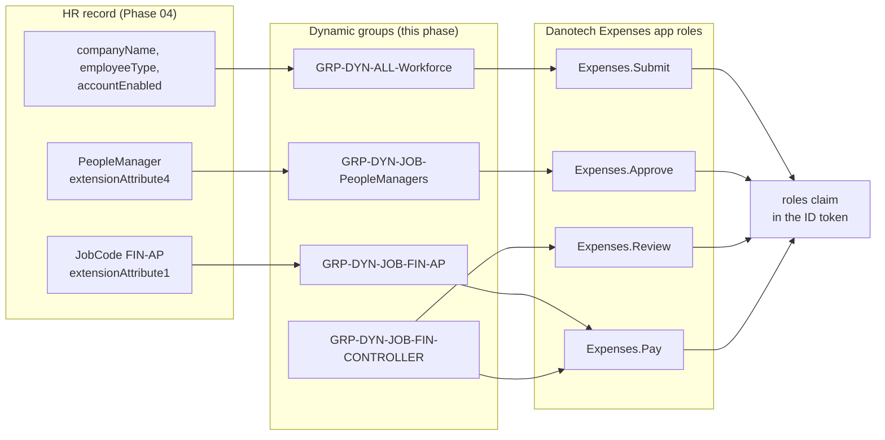
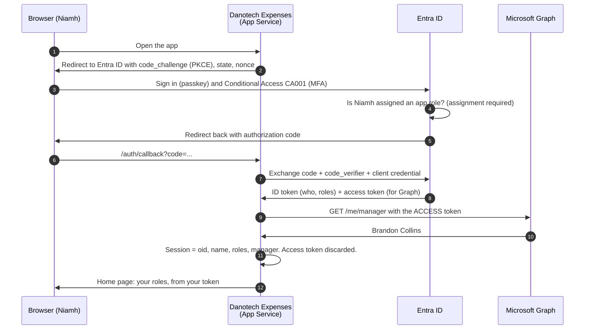
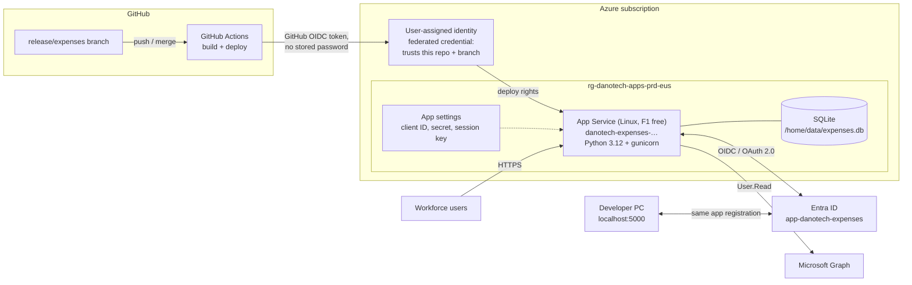
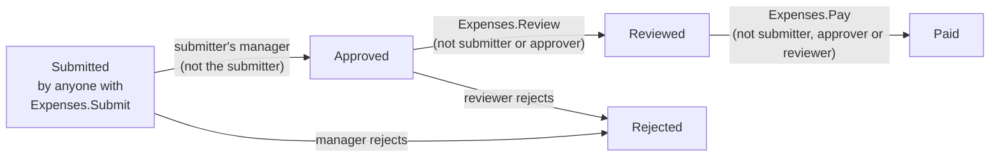

# Phase 05: Groups, App Roles and the Danotech Expenses App

## Scenario

Phase 04 put 199 people into Entra ID, each with a job code, department and people-manager flag from HR. Today those accounts can sign in, but they can't *do* anything: no group membership, no application access.

Rachel Okafor, Financial Controller, owns DanotechInc's expense process. It runs on a spreadsheet and email chains. Approvals get lost, people approve their own claims, and her own situation (approving her team's claims while also being the backup for releasing payments) was flagged as a separation-of-duties exception in Phase 03 (EXC-001). The exception was approved on one condition: *the system must stop her paying any claim she approved*.

So the IAM team builds two things in this phase:

1. **The groups**: one per automatic role in the Phase 03 model, populated from HR attributes. These groups are the bridge between "what HR says about a person" and "what every application lets them do".
2. **Danotech Expenses**: a real web app that signs people in with OpenID Connect, takes its authorization entirely from Entra ID app roles, and enforces the Phase 03 separation-of-duties rules, including Rachel's control.

## What DanotechInc wants

1. **41 dynamic groups** created from the Phase 03 model and proven, person by person, to contain exactly who the model says.
2. **Group-based licensing** for the 25-seat cohort.
3. **An OIDC application** that:
   - signs users in with the **authorization code flow + PKCE**
   - shows the difference between the **ID token** (who you are) and the **access token** (permission to call an API)
   - authorizes from **app roles** assigned to groups, never from a user list in the app
   - enforces separation of duties on the server and logs every denial for auditors
   - runs at a **public HTTPS address** on Azure App Service
4. **Movers' access changes with no action in the app.** Miguel Hernández's move to Finance on 10 November should change what he can do in Danotech Expenses at his next sign-in.

## Architecture

### From HR attribute to application permission

Nobody assigns anyone to anything by hand. HR sets an attribute, a dynamic rule puts the person in a group, the group carries an app role, and the app role appears in the token. When Miguel's job code changes from `SAL-OPS` to `FIN-FPA`, he leaves `GRP-DYN-JOB-SAL-LEADER`, joins `GRP-DYN-JOB-FIN-FPA`, and his next token carries `Expenses.Audit`.

### The groups

All 41 groups come from [`phase-03-rbac-design/generated/dynamic-group-rules.json`](../phase-03-rbac-design/generated/dynamic-group-rules.json), the file the Phase 03 simulation generated from the same data it tested.

| Layer | Groups | Example rule |
|---|---|---|
| Birthright | 1 | `GRP-DYN-ALL-Workforce`: enabled, DanotechInc, Employee/Contractor/Intern |
| Department | 11 | `GRP-DYN-DEPT-Finance`: `user.department -in ["Finance"]` |
| Job | 29 | `GRP-DYN-JOB-FIN-AP`: `user.extensionAttribute1 -in ["FIN-AP"]` and employee only |
| Licensing | 1 (assigned) | `GRP-LIC-EntraSuite`: the 25-person cohort ([ADR-0006](../docs/adr/0006-trial-window-build-order-and-licensed-cohort.md)) |

Every dynamic rule starts with two guards: `user.accountEnabled -eq true` (pre-hires and leavers are never members) and `user.companyName -eq "DanotechInc"` (guests can never match a workforce role). Privileged groups (Phase 06) and access-package groups (Phase 12) are created in their own phases.

### Sign-in: OIDC and OAuth 2.0 in one flow

| Token | Audience | Used for | Kept? |
|---|---|---|---|
| **ID token** (OIDC) | Danotech Expenses | Who the user is (`oid`, `name`), what they may do (`roles`), how they authenticated (`amr`) | Selected claims in the session |
| **Access token** (OAuth 2.0) | Microsoft Graph | Calling `/me/manager` once with `User.Read` | No: used once, then discarded |

**PKCE** binds the authorization code to the browser session that started the sign-in, so an intercepted code is useless. **Assignment required** means Entra ID refuses to issue a token to anyone without an app role. The app never even sees them.

### Hosting and deployment

The App Service is created in the **Azure portal**, and code reaches it through **Deployment Center**, which generates a GitHub Actions workflow. The workflow signs in to Azure with a short-lived GitHub OIDC token exchanged for the managed identity: there's no deployment password anywhere. Releases come from a `release/expenses` branch because `main` only accepts reviewed pull requests (Phase 00); a release is a merge from `main`.

The same code runs locally (`http://localhost:5000`) and in Azure (`https://…azurewebsites.net`); only the redirect URI differs. Secrets live in a file in your user profile (local) and in App Service settings (cloud), never in the repository.

> **Known weakness, fixed later:** the app proves its identity to Entra ID with a **client secret** valid for 30 days. That's exactly the kind of long-lived secret finding F-07 is about. It's deliberate: **Phase 10** replaces it with the App Service managed identity, removing the secret entirely, and the before-and-after is part of the evidence.

## Separation of duties in the app

| Rule | Enforced as | Source |
|---|---|---|
| Can't approve your own claim | Approver ≠ submitter | AC-11 |
| Only your manager approves | Approver = submitter's manager in Entra ID | Reporting lines from HR |
| Can't review what you submitted or approved | Reviewer ∉ {submitter, approver} | Four-eyes |
| **Can't pay a claim you approved** | Payer ≠ approver | **SOD-01, the EXC-001 compensating control** |
| Can't pay what you reviewed | Payer ≠ reviewer | Four-eyes |
| No role, no page | 403 if the token lacks the role | AC-01 |

Every allowed **and denied** action goes to an activity log that only `Expenses.Audit` holders (FP&A, Legal compliance, GRC) can read. Auditors see attempted violations, not just successful transactions.

These rules were tested end to end against seven personas before deployment: the full approval chain, every block (including Rachel trying to pay a claim she approved), and 403s for users without a role.

## The demo story

| Step | Who | Does | Result |
|---|---|---|---|
| 1 | Niamh Jones (new AE) | Submits a $340 client dinner | Goes to her manager, Brandon Collins |
| 2 | Brandon Collins | Approves | Approved |
| 3 | Rachel Okafor | Reviews | Reviewed |
| 4 | Ama Amoah (AP) | Pays | Paid |
| 5 | Ama Amoah | Submits a $95 taxi claim | Goes to her manager, Rachel |
| 6 | Rachel Okafor | Approves, then tries to review it | **Blocked**: can't review what you approved |
| 7 | Kwabena Kyei (Senior Accountant) | Reviews | Reviewed |
| 8 | Rachel Okafor | Tries to pay it | **Blocked: SOD-01** (EXC-001 control) |
| 9 | Ama Amoah | Tries to pay her own claim | **Blocked** |
| 10 | Nana Agyeman (GRC) | Opens Audit | Sees every claim and all three denials |
| 11 | Miguel Hernández (moved to FP&A) | Signs in | Token now carries `Expenses.Audit`; no Salesforce manager role group |

## Folder contents

| Path | Purpose |
|---|---|
| [`app/`](app/) | Danotech Expenses: Flask + MSAL (`app.py`, templates, `requirements.txt`, `expenses.env.example`) |
| [`config/expenses-app-roles.json`](config/expenses-app-roles.json) | The five app roles to create in the portal, mapped to Phase 03 entitlements |
| [`config/licensing-cohort-import.csv`](config/licensing-cohort-import.csv) | Bulk-import file for the licensing group (23 members) |
| [`scripts/powershell/01-New-RoleGroups.ps1`](scripts/powershell/01-New-RoleGroups.ps1) | Creates 40 groups from the model; checks the portal-built one; repairs drift |
| [`scripts/powershell/02-Test-GroupMembership.ps1`](scripts/powershell/02-Test-GroupMembership.ps1) | Person-by-person check of every group against the model |
| [`scripts/powershell/03-Set-ExpensesAppRoleAssignments.ps1`](scripts/powershell/03-Set-ExpensesAppRoleAssignments.ps1) | Checks the portal-built app registration; assigns the other 8 roles from the model |
| [`scripts/powershell/04-Start-ExpensesLocal.ps1`](scripts/powershell/04-Start-ExpensesLocal.ps1) | Runs the app on localhost |
| [`scripts/powershell/05-Get-Phase05Evidence.ps1`](scripts/powershell/05-Get-Phase05Evidence.ps1) | Exports groups, role assignments, sign-ins, app configuration |

**Portal vs script** ([ADR-0010](../docs/adr/0010-portal-and-script-balance.md)): built by hand in the portals: the first group, the licensing group (with bulk import), the app registration, its roles, consent and secret, the first role assignment, the App Service and Deployment Center. Scripted: the other 40 groups, the membership proof, the other 8 role assignments, local runs and evidence. The scripts verify the portal work before building on it.

## Controls delivered

| Control | Evidence |
|---|---|
| Access granted through roles driven by HR data | Group rules; membership test (0 differences) |
| Application access limited to assigned roles | Assignment required; sign-in log shows a user without a role being refused |
| Authorization from the identity provider, not the app | `roles` claim; app has no user table |
| Separation of duties enforced in the business process | Activity log with SOD-01 denial |
| Licences assigned by group | `GRP-LIC-EntraSuite` with no licence errors (portal screenshot) |
| Secretless deployment pipeline | Deployment Center with a user-assigned identity; Actions run linked to a commit |
| Movers' access recalculated automatically | Miguel Hernández: before/after group membership and token roles |

**Walkthrough:** [WALKTHROUGH.md](WALKTHROUGH.md) · **Decision record:** [ADR-0009](../docs/adr/0009-expenses-app-hosting-and-authorization.md)
**Previous:** [Phase 04](../phase-04-jml-lifecycle/) · **Next:** [Phase 06: Privileged access](../phase-06-privileged-access/)
