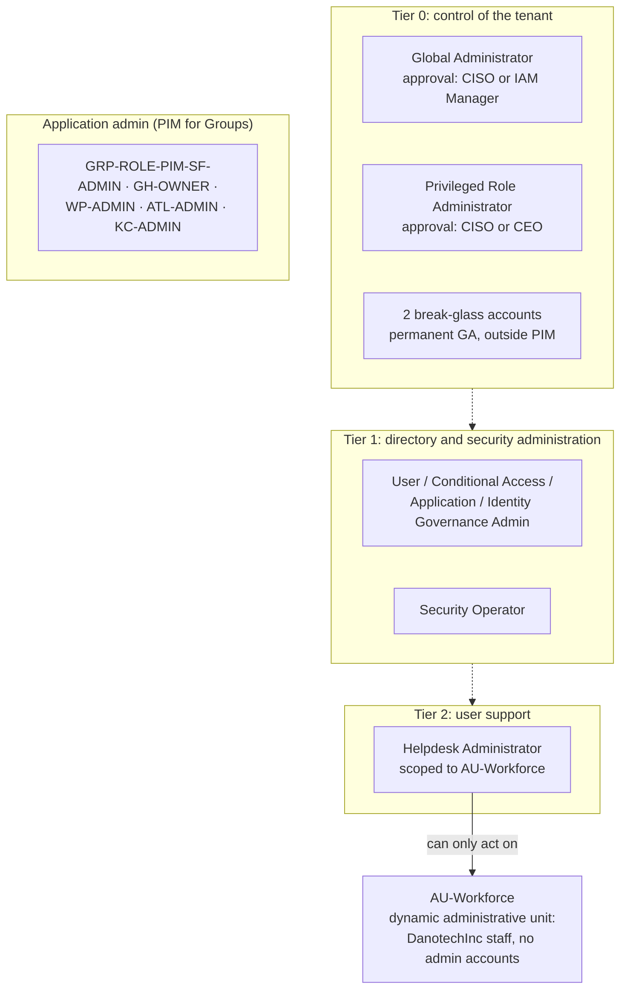
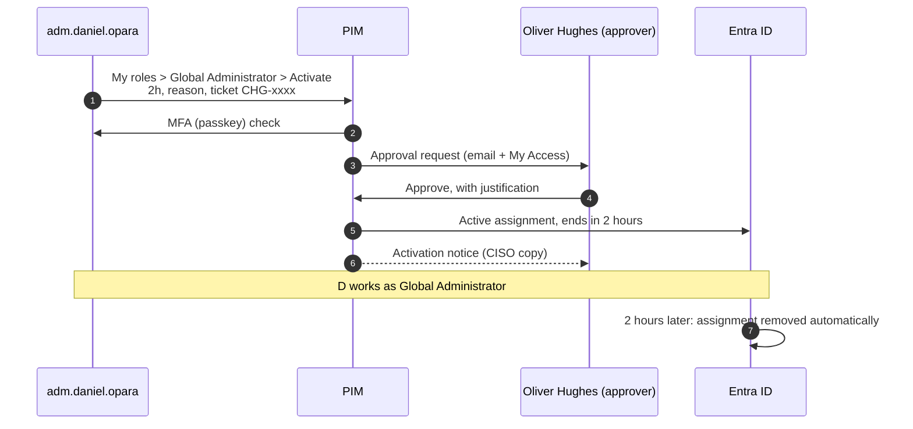

# Phase 06: Privileged Access

## Scenario

Phase 01 took Global Administrator off Daniel Opara's everyday account, but his admin account `adm.daniel.opara` still holds it **permanently**. Every minute of every day, that account can do anything in the tenant. And it's not the only admin need: the IAM team creates users and Conditional Access policies, the Service Desk resets MFA, the SOC investigates sign-ins, and application owners administer Salesforce, GitHub and WordPress.

Oliver Hughes, the CISO, sets three conditions:

1. *"Admin rights live on admin accounts, never on the accounts people read email with."* (Policy AC-10)
2. *"Nobody holds admin rights they aren't using right now. You switch them on when you need them, say why, and they switch off by themselves."* (AC-09)
3. *"Global Administrator needs a second person to say yes."*

The Phase 03 role model already names the 14 people who need admin rights and what each needs. This phase makes it real with **Privileged Identity Management (PIM)**.

## What DanotechInc wants

1. A **dedicated admin account** (`adm.first.last`) for each of the 14 administrators, with no password anyone knows, signed in with a passkey.
2. **Zero standing privilege**: every admin role is *eligible*, activated just-in-time with MFA and a reason, and expires automatically. The only permanent Global Administrators are the two break-glass accounts.
3. **Approval** for the two roles that can take over the tenant (Global Administrator, Privileged Role Administrator).
4. A **tiered model**: Service Desk can only touch workforce accounts, never admin or break-glass accounts.
5. **Just-in-time application admin** (Salesforce, GitHub, WordPress, Atlassian, Keycloak) through PIM-managed groups, connected to the apps in Phase 08.
6. A repeatable **control test** proving all of the above, and alerting if it drifts.

## The 14 administrators

| Admin account | Person | Tier | Eligible for |
|---|---|---|---|
| `adm.daniel.opara` | Daniel Opara, CEO | T0 | Global Administrator (**approval**) |
| `adm.adaeze.nwosu` | Adaeze Nwosu, IAM Manager | T0 | Privileged Role Administrator (**approval**); User, Conditional Access, Application, Identity Governance Administrator |
| `adm.kofi.owusu` | Kofi Owusu | T1 | User, CA, Application, Identity Governance Admin · Salesforce and Keycloak admin groups |
| `adm.diego.ramirez` | Diego Ramírez | T1 | User, CA, Application, Identity Governance Admin · Salesforce, WordPress, Atlassian admin groups |
| `adm.emily.carter` | Emily Carter | T1 | User, CA, Application, Identity Governance Admin · GitHub owner group |
| `adm.priya.sharma` | Priya Sharma, SOC Manager | T1 | Security Operator · (Log workspace admin: Phase 09) |
| `adm.ashley.johnson` | Ashley Johnson, Detection Engineer | T1 | Security Operator |
| `adm.grace.robinson` | Grace Robinson, Service Desk Lead | T2 | Helpdesk Administrator, **scoped to AU-Workforce** |
| `adm.tobiloba.akinola`, `adm.ximena.garcia`, `adm.jamal.davis` | Service Desk Analysts | T2 | Helpdesk Administrator, scoped to AU-Workforce |
| `adm.ngozi.balogun` | Ngozi Balogun, Dir. Digital Marketing | App | WordPress admin group |
| `adm.carlos.gutierrez` | Carlos Gutiérrez, DevOps & SRE | App | GitHub owner group |
| `adm.babatunde.bakare` | Babatunde Bakare, Cloud & Infra | Azure | Azure subscription roles (Phase 09) |

Aisha Okonkwo, the Service Desk **contractor**, is deliberately absent: policy AC-07 keeps contractors out of admin roles. Generated from the Phase 03 model into [`config/privileged-access-design.json`](config/privileged-access-design.json).

> **Licensing:** only `adm.daniel.opara`, `adm.adaeze.nwosu` and `adm.kofi.owusu` hold Entra Suite seats ([ADR-0006](../docs/adr/0006-trial-window-build-order-and-licensed-cohort.md)). PIM technically works for the other 11, but a production tenant would license every eligible user. That's recorded as a lab licensing gap, not a design choice.

## Architecture

### Tiers

| Tier | Activation | Max | Requires |
|---|---|---|---|
| T0 | Approval by a named second person | 2 hours | MFA, justification, ticket number |
| T1 | Self-activate | 4 hours | MFA, justification |
| T2 | Self-activate | 8 hours (a shift) | MFA, justification |
| App | Self-activate group membership | 4 hours | MFA, justification |
| All | Eligibility expires after **180 days**; active assignments after **30 days**; activations email the CISO | | |

Phase 07 upgrades T0 activation from "MFA" to an **authentication context** that requires a phishing-resistant passkey, so even an approved activation can't happen from a phished session.

### Why an administrative unit for the Service Desk

Helpdesk Administrator at tenant scope can reset passwords and MFA for every non-admin user, including people who aren't DanotechInc staff. Scoping it to **AU-Workforce**, a dynamic administrative unit containing only `companyName = DanotechInc` accounts that aren't admin accounts, means a compromised helpdesk account can never touch an admin or break-glass account, even indirectly. That's the tiering principle: lower tiers can't control higher tiers.

### Activation: just-in-time Global Administrator

### Application admin: PIM for Groups

Application admin rights aren't Entra ID roles, so they're delivered through groups. Each `GRP-ROLE-PIM-*` group is **role-assignable** (only Privileged Role Administrators can change it) and managed by PIM: its members are *eligible*, never standing. In Phase 08 each group is assigned to its application's admin role. When Ngozi activates WordPress admin, she becomes a member for 4 hours; her next WordPress sign-in carries the admin role; afterwards it doesn't.

### What stays standing

| Access | Who | Why it isn't just-in-time |
|---|---|---|
| Global Administrator | 2 break-glass accounts | They exist for when PIM, MFA or approvers are unavailable (Phase 01) |
| Global Reader | IAM team, GRC (daily accounts) | Read-only (High, not Privileged); synced from dynamic groups by script 04 |
| Security Reader | SOC employees (daily accounts) | Read-only; contractor Musa Afolabi excluded by the Phase 03 model |

## Portal vs script ([ADR-0010](../docs/adr/0010-portal-and-script-balance.md))

| Built by hand in the portal | Scripted (and checks the hand-built item) |
|---|---|
| `adm.adaeze.nwosu` | The other 12 admin accounts (`01`) |
| AU-Workforce | Helpdesk eligibility scoped to it (`03`) |
| Global Administrator role settings | Settings for the other 7 roles (`02`) |
| `adm.daniel.opara`: active GA converted to eligible | 23 other eligible assignments (`03`) |
| `GRP-ROLE-PIM-WP-ADMIN` with Ngozi eligible | The other 4 PIM groups (`03`) |
| Activation, approval, PIM alerts, audit history | Reader-role sync (`04`), control test (`05`), evidence (`06`) |

## Folder contents

| Path | Purpose |
|---|---|
| [`config/privileged-access-design.json`](config/privileged-access-design.json) | Admins, tiers, role settings, eligibility, PIM groups (from the Phase 03 model) |
| [`scripts/powershell/01-New-AdminAccounts.ps1`](scripts/powershell/01-New-AdminAccounts.ps1) | Admin accounts; `GRP-DYN-ALL-AdminAccounts`; licensing for 2 admin accounts |
| [`scripts/powershell/02-Set-PimRoleSettings.ps1`](scripts/powershell/02-Set-PimRoleSettings.ps1) | Role settings for 8 directory roles |
| [`scripts/powershell/03-New-PimEligibility.ps1`](scripts/powershell/03-New-PimEligibility.ps1) | Directory eligibility and PIM-managed groups |
| [`scripts/powershell/04-Sync-StandingReaderRoles.ps1`](scripts/powershell/04-Sync-StandingReaderRoles.ps1) | Global Reader / Security Reader from dynamic groups |
| [`scripts/powershell/05-Test-PrivilegedAccess.ps1`](scripts/powershell/05-Test-PrivilegedAccess.ps1) | Control test PA-01 to PA-06; disables orphaned admin accounts with `-Remediate` |
| [`scripts/powershell/06-Get-PimEvidence.ps1`](scripts/powershell/06-Get-PimEvidence.ps1) | Eligibility, role settings and activation history |
| `scripts/powershell/_PimPolicy.ps1` | Shared helpers for reading and applying PIM role settings |

## Controls delivered

| Control | Evidence |
|---|---|
| No standing privileged access except break-glass (AC-09) | Control test PA-01 |
| Privileged roles only on admin accounts (AC-10) | PA-02 |
| Admin access matches the approved role model (AC-01) | PA-03; eligible assignments export |
| Contractors excluded from admin roles (AC-07) | PA-04 |
| Leavers lose admin accounts too | PA-05 with remediation |
| Second-person approval for Tier 0 | Activation history with approver; role settings export |
| Helpdesk can't act on privileged accounts | AU-scoped eligibility; failed reset attempt screenshot |

**Walkthrough:** [WALKTHROUGH.md](WALKTHROUGH.md) · **Decision record:** [ADR-0012](../docs/adr/0012-privileged-access-design.md)
**Previous:** [Phase 05](../phase-05-groups-app-roles/) · **Next:** [Phase 07: Zero Trust Conditional Access](../phase-07-zero-trust-conditional-access/)
