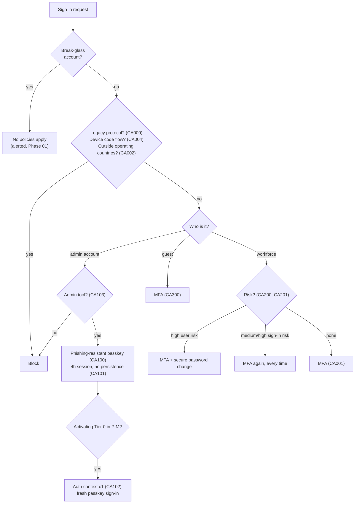
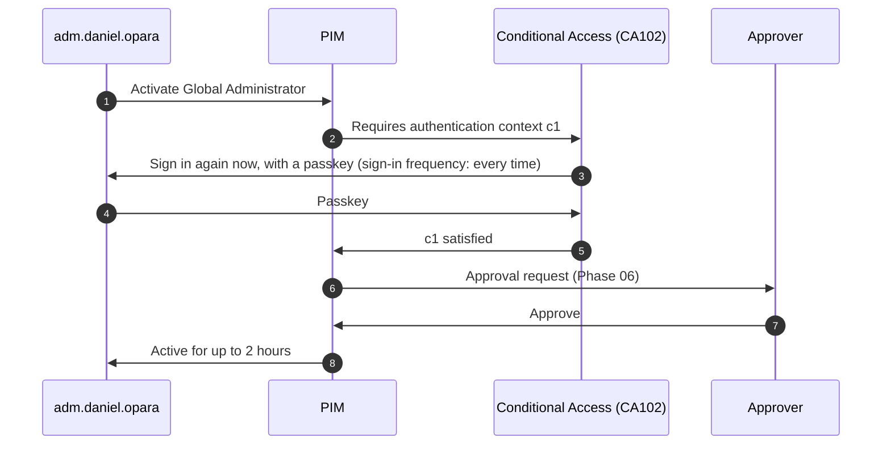
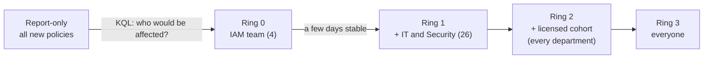

# Phase 07: Authentication and Zero Trust Conditional Access

## Scenario

In August, CFO Kwame Asante got a burst of MFA push notifications at 2 a.m. He didn't approve them, but the attacker already had his password. Phase 01 made MFA mandatory, but *MFA* still includes the push he was being bombarded with, and a convincing phishing page can relay any code or push approval straight to the attacker.

Oliver Hughes wants DanotechInc's access decisions to follow Zero Trust:

- **Verify explicitly.** Every sign-in is judged on who, how strongly they proved it, from where, and how risky it looks. Being "on the office network" counts for nothing.
- **Use least privilege.** Admin accounts can only reach admin tools. Tier 0 activation needs a fresh, phishing-resistant sign-in.
- **Assume breach.** Risky sign-ins get challenged; users whose credentials look leaked must reset them; stolen sessions shouldn't last.

And he wants it done without breaking the company: nothing switched on for 200 people in one go.

## What DanotechInc wants

1. **Passkeys** as the standard sign-in method, phishable methods (SMS, voice) switched off, and adoption measured.
2. **Admins can only sign in phishing-resistantly**, have short sessions, and can only reach admin tools with their admin accounts.
3. **PIM activation for Tier 0** requires a fresh passkey sign-in, through an authentication context.
4. **Risk-based access:** risky sign-ins challenged; high-risk users forced to a secure password reset.
5. **Location awareness:** sign-ins from outside DanotechInc's five operating countries blocked.
6. **Token-theft-prone flows blocked** (device code phishing).
7. A **safe rollout:** report-only first, measured impact, then rings, with a test proving the end state.

## The Conditional Access framework

Policies are numbered by **persona** ([naming conventions](../docs/naming-conventions.md)), so the policy list reads as a design:

| Policy | Persona | Does | Phase |
|---|---|---|---|
| CA000 | All users | Block legacy authentication | 01 |
| CA001 | All users | Require MFA | 01 |
| **CA002** | All users | Block sign-ins from outside US, GB, NG, GH, MX | 07 (portal) |
| **CA003** | All users | Registering security info needs a passkey, or a one-time TAP | 07 |
| **CA004** | All users | Block device code flow | 07 |
| **CA100** | Admins | Require **phishing-resistant MFA** (upgraded from Phase 01's MFA) | 07 |
| **CA101** | Admins | Sign in again every 4 hours; no persistent browser sessions | 07 |
| **CA102** | Admins | Authentication context `c1` (PIM Tier 0 activation): passkey, every time | 07 |
| **CA103** | Admin accounts | Block everything except admin tools | 07 |
| **CA200** | Workforce | Medium/high sign-in risk: MFA again, every time | 07 |
| **CA201** | Workforce | High user risk: MFA + secure password change | 07 |
| **CA300** | Guests | Require MFA (enforced now, before Phase 12 brings guests in) | 07 |
| CA400 | Workload identities | Risk-based blocking for service principals (needs Workload ID Premium; designed in Phase 10) | Design only |

Every policy excludes `GRP-CA-Exclude-BreakGlass`. That's checked automatically (CA-01).

### How a sign-in is evaluated

All matching policies apply together, and **every** grant must be satisfied. A block anywhere wins.

### Authentication strengths

| Strength | Methods | Used by |
|---|---|---|
| Multifactor authentication (built-in) | Any MFA | CA200, CA300 |
| **Phishing-resistant MFA** (built-in) | Passkeys (FIDO2, incl. Microsoft Authenticator), Windows Hello for Business, certificate-based | CA100, CA102 |
| **AS-Onboarding-Passkey-or-TAP** (custom) | One-time TAP, passkey, Windows Hello, certificate, Authenticator passwordless, *and during the rollout* password + Authenticator push | CA003 (registering security info) |

Why passkeys resist phishing: a passkey is bound to the real sign-in domain. A fake page on another domain can't ask for it, and there's no code to relay. That's exactly what defeats the attack on Kwame Asante.

### PIM activation with an authentication context

A session stolen hours earlier, or a push approved by a tired admin, can't satisfy `c1`: it demands a passkey sign-in at the moment of activation.

### Safe rollout

Workforce policies (CA002, CA004, CA200, CA201) move through rings with `02-Set-CaRolloutRing.ps1`. Admin policies affect 14 known accounts, so they go straight from report-only to enforced, once every admin account has a passkey. Each ring change is logged to `evidence\rollout-log.csv`.

## Things this phase doesn't do (and why)

| Control | Status | Reason |
|---|---|---|
| Require compliant or hybrid-joined devices | Designed, not enforced | No Intune licences (charter section 5). Device-based policies would block everyone |
| Token protection (session binding) | Designed, not enforced | Requires registered Windows devices |
| Workload identity risk policies (CA400) | Phase 10 design | Needs Workload ID Premium |
| Continuous access evaluation, strict mode | Default (non-strict) | Strict location enforcement needs stable IP ranges; DanotechInc staff roam |

## Portal vs script ([ADR-0010](../docs/adr/0010-portal-and-script-balance.md))

| Built by hand in the portal | Scripted |
|---|---|
| Authentication methods policy (passkeys on, SMS and voice off) | Policy and adoption checks (`04`) |
| Named location `NL-Operating-Countries` | Resolved by name at deploy time |
| Authentication strength `AS-Onboarding-Passkey-or-TAP` | Resolved by name |
| Authentication context `c1` | Applied to Tier 0 PIM settings (`03`) |
| **CA002** (country block) | 9 other policies deployed; CA002 and CA100 checked against their definitions (`01`) |
| What If; report-only insights; risky sign-ins | Ring rollout (`02`), control test and evidence (`05`) |

## Folder contents

| Path | Purpose |
|---|---|
| [`policies/`](policies/) | 10 policy definitions with placeholders (no tenant IDs in Git) |
| [`config/zero-trust-config.json`](config/zero-trust-config.json) | Named location, authentication strength, context, groups, rings, admin-allowed apps |
| [`scripts/powershell/01-Deploy-ConditionalAccess.ps1`](scripts/powershell/01-Deploy-ConditionalAccess.ps1) | Deploy new policies as report-only; compare and update existing |
| [`scripts/powershell/02-Set-CaRolloutRing.ps1`](scripts/powershell/02-Set-CaRolloutRing.ps1) | Move workforce policies through rings 0–3 |
| [`scripts/powershell/03-Set-PimAuthenticationContext.ps1`](scripts/powershell/03-Set-PimAuthenticationContext.ps1) | Tier 0 PIM activation requires context `c1` |
| [`scripts/powershell/04-Get-AuthMethodsReport.ps1`](scripts/powershell/04-Get-AuthMethodsReport.ps1) | Methods policy checks; passkey adoption |
| [`scripts/powershell/05-Test-ConditionalAccess.ps1`](scripts/powershell/05-Test-ConditionalAccess.ps1) | Control test CA-01 to CA-07; policy export |
| [`kql/`](kql/) | Report-only impact; risky sign-ins |

## Controls delivered

| Control | Evidence |
|---|---|
| Phishing-resistant authentication for all administrators (O4) | CA100 enforced; adoption report shows 100% admin passkeys |
| Step-up for privileged activation | CA102 + PIM context `c1`; activation sign-in log shows `fido` |
| Admin accounts restricted to admin tools | CA103; sign-in log of a blocked business-app attempt |
| Risk-based access | CA200/CA201; risky sign-in test |
| Location-based restriction | CA002; What If result |
| Phishable methods disabled | AM-02 |
| Changes measured before enforcement | Report-only KQL output; rollout log |
| Break-glass excluded everywhere | CA-01 |

**Walkthrough:** [WALKTHROUGH.md](WALKTHROUGH.md) · **Decision record:** [ADR-0013](../docs/adr/0013-zero-trust-conditional-access.md)
**Previous:** [Phase 06](../phase-06-privileged-access/) · **Next:** [Phase 08: SSO and federation](../phase-08-sso-federation/)
