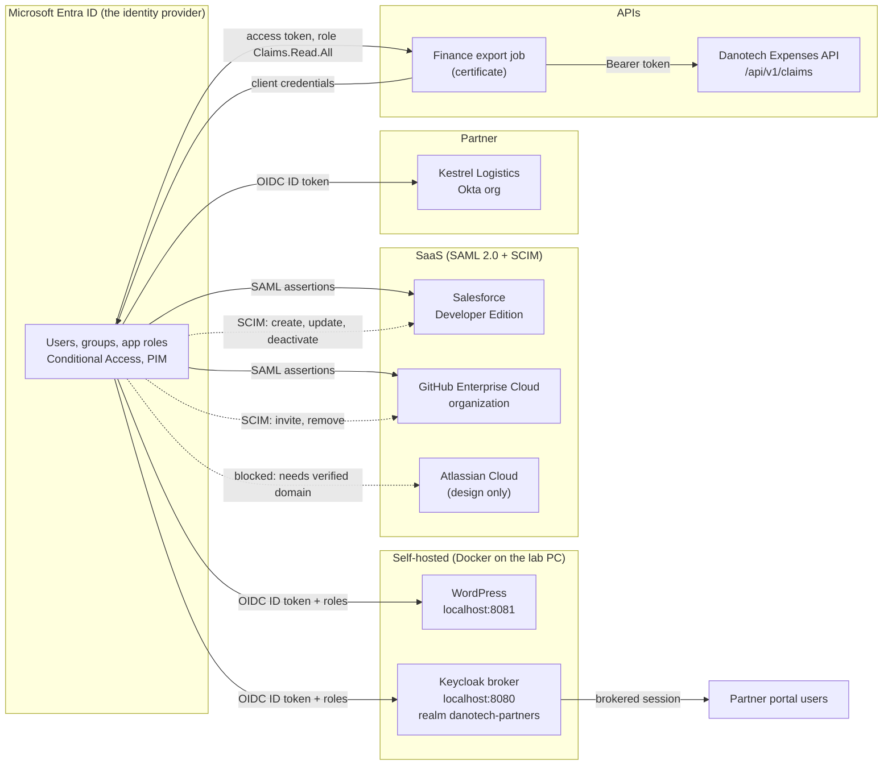
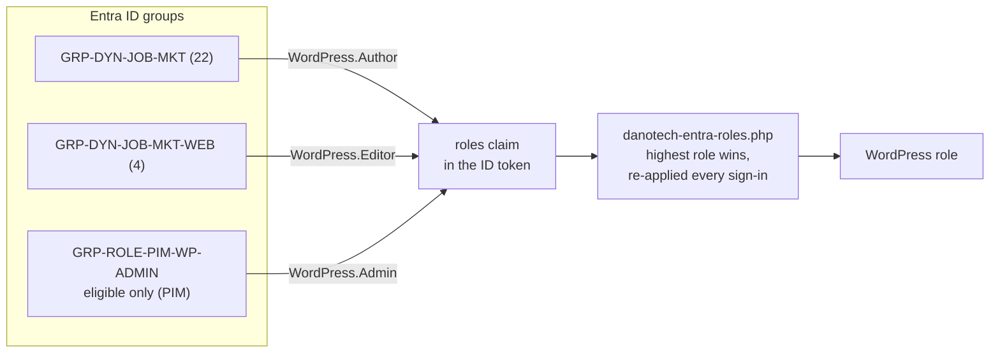
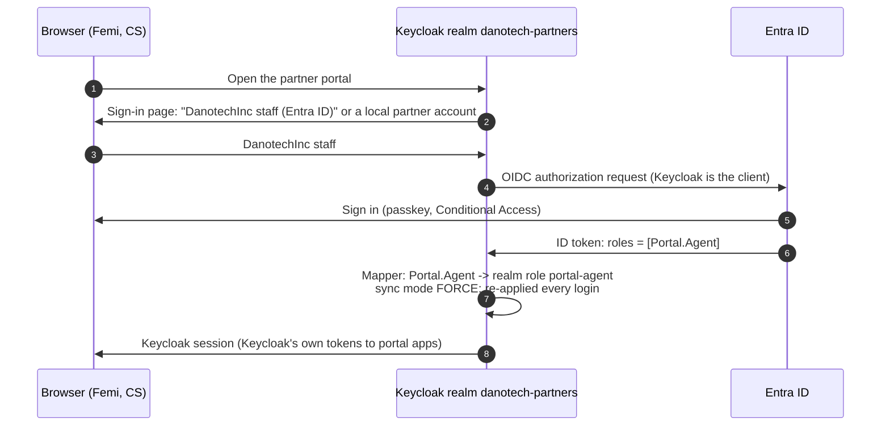
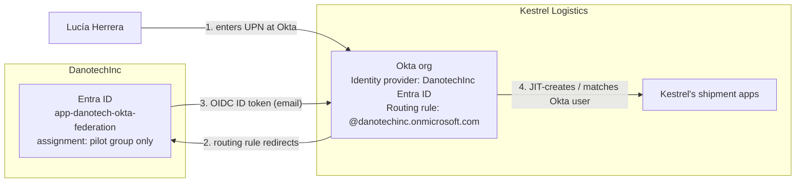

# Phase 08: SSO and Federation

## Scenario

Finding F-03 from the readiness assessment: *no central identity provider; every application has its own password*. That's how the CFO's reused password ended up in an attacker's hands, and why seven leavers still had Salesforce and GitHub access months after leaving (F-02).

Now that Entra ID knows who everyone is (Phase 04), what they should have (Phases 03, 05), and how strongly they've proved it (Phase 07), every application should **trust Entra ID** instead of keeping its own passwords:

- **Fernanda Castillo** (Sales Ops) wants Salesforce accounts created and removed from the HR record, with sign-in through Entra ID.
- **Carlos Gutiérrez** (DevOps) wants GitHub organization access tied to company identity, so a leaver loses the source code the day they leave.
- **Ngozi Balogun** (Digital Marketing) wants the five people sharing the WordPress admin password (F-05) replaced by named people, with admin rights only when needed.
- **Lucía Herrera** (Customer Success) runs a **partner portal on Keycloak** for logistics partners. Her team should sign in with their DanotechInc account; partners keep their own Keycloak accounts.
- **Kestrel Logistics**, a key partner, runs **Okta**. DanotechInc's CS staff need to sign in to Kestrel's systems without getting a second password.
- **Rachel Okafor** (Finance) wants the month-end export job to read paid expense claims through an API, with no password or stored user account.
- **Yaw Darko** (Product Engineering) wants Jira and Confluence on Entra ID too.

## What DanotechInc wants

Every major federation pattern, each on a real platform:

| Need | Pattern | Platform |
|---|---|---|
| SSO to a SaaS app | **SAML 2.0** | Salesforce, GitHub |
| Accounts created and removed automatically | **SCIM** (outbound provisioning) | Salesforce, GitHub |
| SSO to a self-hosted app, roles from Entra ID | **OIDC** | WordPress |
| A second identity system that trusts Entra ID | **Identity brokering** | Keycloak |
| Signing in to another company's identity provider | **Federation between IdPs** | Okta |
| A program calling an API with no user | **OAuth 2.0 client credentials** | Danotech Expenses API |
| (Already in Phase 05) user sign-in with roles | OIDC authorization code + PKCE | Danotech Expenses |
| (Already in Phase 04) inbound provisioning from HR | SCIM (inbound, API-driven) | HR feed |

## Architecture



### The protocols, side by side

| | SAML 2.0 | OIDC | OAuth 2.0 | SCIM |
|---|---|---|---|---|
| Answers | *Who is this user?* | *Who is this user?* | *What may this app do?* | *Which accounts should exist?* |
| Token | XML assertion | JSON ID token (JWT) | JSON access token (JWT) | None: REST API calls |
| Used here by | Salesforce, GitHub | WordPress, Keycloak, Okta, Expenses | Finance export → Expenses API | Salesforce, GitHub (outbound), HR feed (inbound) |
| Typical era | Enterprise SaaS, 2005+ | Modern web and mobile, 2014+ | APIs | Provisioning, 2015+ |

SAML and OIDC both do **authentication** (sign-in). OAuth does **authorization** for APIs. SCIM is **lifecycle**: SSO alone doesn't remove a leaver's account inside Salesforce. SCIM does.

## Integration by integration

### Salesforce: SAML 2.0 + SCIM

```mermaid
sequenceDiagram
    autonumber
    participant B as Browser (Niamh)
    participant SF as Salesforce (SP)
    participant E as Entra ID (IdP)
    Note over E,SF: Before sign-in: Entra ID SCIM has created Niamh's Salesforce user<br/>Federation ID = niamh.jones@danotechinc.onmicrosoft.com
    B->>SF: Open My Domain, choose "Entra ID"
    SF->>B: SAML AuthnRequest (redirect)
    B->>E: AuthnRequest; sign in (passkey, Conditional Access)
    E->>E: Niamh assigned to "Salesforce - SSO"? (assignment required)
    E->>B: Signed SAML Response (NameID = UPN)
    B->>SF: POST to Assertion Consumer Service
    SF->>SF: Verify signature, find user by Federation ID
    SF->>B: Signed in
```

- **Matching:** the SAML NameID (UPN) matches the Salesforce user's **Federation ID**, which SCIM sets from the same UPN.
- **Lifecycle:** SCIM creates the user when someone is assigned, updates them when HR changes their details, and **deactivates** them (Salesforce never deletes users) when they're unassigned or disabled. A Phase 04 leaver loses Salesforce at the next provisioning cycle.
- **Lab constraint:** Developer Edition has only a handful of user licences. A two-person pilot group (Niamh Jones, Brandon Collins) replaces the production design, where role groups map to Salesforce profiles.
- **App break-glass:** the Salesforce admin who created the org keeps a local login. It's the Salesforce equivalent of Phase 01's break-glass accounts: if SSO breaks, someone can still fix it.

### GitHub Enterprise Cloud: SAML 2.0 + SCIM

- Organization-level SAML: members link their personal GitHub account to their Entra ID identity once; afterwards, access to the organization's resources requires an active Entra ID session.
- SCIM invites assigned users to the organization and **removes** them when unassigned: the fix for F-02's GitHub leavers.
- The SAML NameID and the SCIM `userName` must be identical (both the UPN), or GitHub can't link the two.
- **Limitation:** with organization-level SAML, organization *owner* is a GitHub-side role. Just-in-time owner rights would need Enterprise Managed Users, which is out of scope.

### WordPress: OIDC with just-in-time admin



The *OpenID Connect Generic Client* plugin handles sign-in; a small must-use plugin in this repo maps app roles to WordPress roles on every sign-in. When Ngozi activates `GRP-ROLE-PIM-WP-ADMIN` in PIM (Phase 06) and signs in with her admin account, she's an administrator. When the activation ends, her next sign-in demotes that account to subscriber. The shared admin password from F-05 is gone: the only local admin left is a sealed break-glass account. The role-mapping logic was tested against six cases, including the demotion and leaving the local break-glass admin untouched.

### Keycloak: identity brokering



**Brokering** means Keycloak stays the identity provider *for its own applications*, but delegates authentication of DanotechInc staff to Entra ID. Partners keep local Keycloak accounts; staff never get a Keycloak password. Roles flow from Entra ID groups and are re-applied at every login, so a mover or leaver can't keep a stale role in Keycloak. Realm administration (`Realm.Admin`) comes from the PIM-managed group `GRP-ROLE-PIM-KC-ADMIN`, just-in-time, like WordPress.

### Okta: federation between identity providers



**Direction built in this phase:** Entra ID → Okta. DanotechInc staff sign in to Kestrel's Okta with their own account; Kestrel never stores a password for them, and DanotechInc controls who may federate (assignment) and how they authenticate (Conditional Access).

**Reverse direction, designed for Phase 12:** Okta → Entra ID. Kestrel staff become B2B guests in DanotechInc, authenticating at their own Okta through Entra ID's **SAML/WS-Fed identity provider federation**, governed by access packages and covered by CA300.

### OAuth 2.0 client credentials: Finance export → Expenses API

```mermaid
sequenceDiagram
    autonumber
    participant J as Finance export job<br/>(app-danotech-finance-export)
    participant E as Entra ID
    participant A as Expenses API<br/>/api/v1/claims
    J->>E: Token request: client_credentials,<br/>scope api://expenses/.default,<br/>client assertion signed with its CERTIFICATE
    E->>E: Admin granted Claims.Read.All?
    E->>J: Access token: aud = Expenses, roles = [Claims.Read.All], no scp
    J->>A: GET /api/v1/claims?status=Paid, Bearer token
    A->>A: Verify signature (Entra ID keys), issuer, audience, expiry;<br/>app-only + Claims.Read.All?
    A->>J: Paid claims (JSON); access written to the audit log
```

The API's token validation was tested against ten cases before deployment: valid daemon and auditor tokens accepted; missing role, wrong audience, wrong issuer, expired and forged-signature tokens rejected, every decision written to the audit log. The client authenticates with a **certificate**, never a secret. Delegated access (`Claims.Read` for an auditor through another app) is already accepted by the API; Phase 11 uses it with on-behalf-of.

### Atlassian Cloud: designed, blocked

Atlassian's SAML SSO and SCIM need **Atlassian Guard** *and* a **verified domain**: Atlassian only applies SSO to accounts on domains you've proved you own (DNS record or HTML file). DanotechInc can't verify `danotechinc.onmicrosoft.com`, which belongs to Microsoft ([ADR-0001](../docs/adr/0001-use-onmicrosoft-domain.md)). Rather than pretend, the design is documented (gallery app *Atlassian Cloud*, SAML with NameID = UPN, SCIM via Atlassian's Entra ID directory connector, groups `GRP-DYN-JOB-*` → Jira and Confluence product access, `GRP-ROLE-PIM-ATL-ADMIN` → org admin) and recorded as a known gap. If a custom domain is ever verified, it can be built as designed.

## Admin accounts and Conditional Access

Phase 07's CA103 blocks admin accounts from everything except admin tools. WordPress and the Keycloak broker are administered just-in-time **by admin accounts** (policy AC-10), so `04-Update-AdminAllowedApps.ps1` adds exactly those two apps to CA103's allow-list, through the reviewed Phase 07 config. Salesforce and GitHub admin stay with their local app break-glass in the lab.

## Portal vs script ([ADR-0010](../docs/adr/0010-portal-and-script-balance.md))

| Built by hand (Entra admin center, the external platform, Docker) | Scripted |
|---|---|
| Every gallery app, SAML configuration and certificate exchange | Pilot groups and lab mail addresses (`01`) |
| Every app registration, app roles, consent, secret or certificate | Remaining role-to-group assignments (`02`) |
| Provisioning connections, *Provision on demand*, provisioning logs | Control test FA-01 to FA-06 (`03`) |
| Salesforce, GitHub, WordPress, Keycloak and Okta configuration | CA103 allow-list (`04`), evidence (`05`) |
| First role assignment per app | OAuth client (`oauth/finance_export_client.py`) |

## Folder contents

| Path | Purpose |
|---|---|
| [`config/federation-design.json`](config/federation-design.json) | Every app: protocols, owners, role-to-group design, pilots, blockers |
| [`wordpress/`](wordpress/) | Docker Compose for WordPress + MariaDB; the role-mapping must-use plugin |
| [`keycloak/`](keycloak/) | Docker Compose for Keycloak |
| [`oauth/`](oauth/) | Client credentials client (certificate) |
| [`scripts/powershell/`](scripts/powershell/) | Pilot groups, assignments, control test, CA103 allow-list, evidence |
| [`kql/`](kql/) | Sign-ins per federated app; assignment refusals |
| [`../phase-05-groups-app-roles/app/app.py`](../phase-05-groups-app-roles/app/app.py) | Expenses app, now with the protected `/api/v1/claims` endpoint |

## Controls delivered

| Control | Evidence |
|---|---|
| Central authentication for every in-scope app (F-03) | Federated sign-ins per app (KQL, export) |
| Automated deprovisioning in SaaS (F-02) | Provisioning log: Salesforce user deactivated, GitHub member removed |
| No shared admin passwords (F-05) | WordPress admin via PIM group; local break-glass only |
| Access only through assigned groups (AC-01) | FA-01 and FA-06; AADSTS50105 refusals |
| Secretless service-to-service access | Finance export with a certificate; token claims |
| API authorization enforced and audited | Expenses audit log: API Success and Denied entries |
| Signing certificates and secrets monitored | FA-03, FA-04 |

**Walkthrough:** [WALKTHROUGH.md](WALKTHROUGH.md) · **Decision record:** [ADR-0014](../docs/adr/0014-sso-and-federation-design.md)
**Previous:** [Phase 07](../phase-07-zero-trust-conditional-access/) · **Next:** [Phase 09: Cloud IAM](../phase-09-cloud-iam/)
